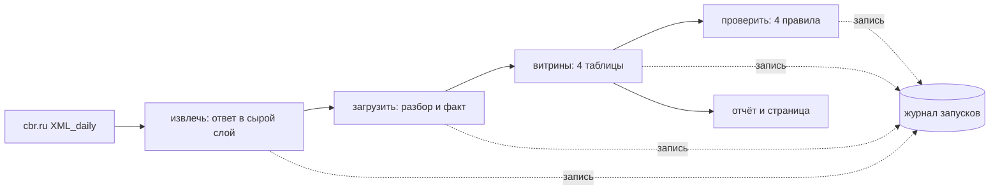

# cbr-marts — ежедневный ETL курсов ЦБ

Каждое утро нужно забрать у Банка России официальные курсы, разложить их в хранилище и обновить витрины: динамика по валютам, средние по месяцам, изменения за день, неделю и месяц. Плюс то, без чего ежедневный конвейер не живёт: повторный запуск ничего не портит, вчерашний день можно догрузить задним числом, а каждая попытка видна в журнале.

Оркестратор здесь свой — полторы сотни строк вместо Airflow с веб-сервером, планировщиком и базой метаданных. Хранилище — один файл DuckDB вместо ClickHouse. Дашборд — страница, а не Superset.

```text
$ cbr backfill --since 18.08.2026 --until 12.09.2026
Дней обработано: 26, с ошибками: 0.

$ cbr run --date 12.09.2026
12.09.2026 — извлечь: пропущено, загрузить: пропущено, витрины: пропущено, проверить: пропущено
  извлечь: пропущено — уже выполнялась в этот день

$ cbr report
Курсы с 18.08.2026 по 12.09.2026: 20 рабочих дней, 54 валют, 1080 значений.

Изменения:
Код  Валюта              Курс, ₽  За день  За неделю  За месяц
CHF  Швейцарский франк  103.4843   -0.59%     -3.35%         —
CNY  Юань                12.5519   -0.09%     -2.58%         —
EUR  Евро                97.8728   -0.42%     -2.68%         —
GBP  Фунт стерлингов    114.0080   -0.35%     -2.60%         —
JPY  Иен                  0.5450   -0.71%     -1.80%         —
KZT  Тенге                0.1869   +1.24%     -1.60%         —
TRY  Турецких лир         1.7390   -0.15%     -3.06%         —
USD  Доллар США          84.2569   -0.11%     -2.69%         —

Доллар по месяцам:
Год   Месяц  Дней  Средний  Минимум  Максимум  Размах
2026  08       10  84.5172  82.9211   85.9541  +3.66%
2026  09       10  86.0332  84.2569   86.9963  +3.25%

Последние запуски:
День   Задача     Попытка  Итог    Секунд  Что вышло
12.09  извлечь    1        готово    0.77  ответ за 12.09.2026, 54 валют
12.09  загрузить  1        готово    0.58  54 валют записано на 12.09.2026
12.09  витрины    1        готово    0.03  mart_rate_daily — 1080, mart_month — 108, mart_change — 54
12.09  проверить  1        готово    0.02  проверки пройдены
```

Двадцать шесть календарных дней превратились в двадцать рабочих — и это главное, что делает проект. В выходной ЦБ отдаёт курсы предыдущего рабочего дня, и в ответе стоит его дата. Наивный конвейер записал бы одни и те же курсы на субботу, воскресенье и понедельник, и недельная динамика поехала бы. Здесь факт кладётся по дате из ответа, а по запрошенной дате остаётся только запись в журнале.

## Что внутри

| Свойство | Как сделано |
|---|---|
| Сырой слой | скачанный XML сохраняется файлом как есть; повторная сборка витрин не требует новых запросов к источнику |
| Идемпотентность | ключ факта — «дата курса + валюта»; повторная загрузка того же дня перезаписывает строки, а не добавляет |
| Пропуск сделанного | задача, успешно выполненная за этот день, при повторном запуске не выполняется заново |
| Догрузка за прошлое | `backfill --since --until` — тот же граф по одному дню за раз |
| Повторы при сбое | у каждой задачи своя политика: число попыток и растущая пауза |
| Зависимости | упавшая задача блокирует не только соседа, но и всё, что идёт за ним по цепочке |
| Журнал | каждая попытка записана: день, задача, номер попытки, итог, время, что именно вышло |
| Проверки | четыре: есть ли главные валюты, положительны ли курсы, нет ли дыры в истории, не обрезан ли ответ |
| Витрины | дневная динамика, помесячные средние, изменения за день/неделю/месяц, кросс-курсы |
| Страница | один HTML-файл: карточки валют со спарклайнами и таблица по месяцам |

## Как запустить

```bash
uv sync
uv run cbr demo --offline                              # весь путь без сети, на подставных ответах
uv run cbr run                                         # сегодняшний день
uv run cbr run --date 12.09.2026 --force               # конкретный день, заново
uv run cbr backfill --since 01.08.2026 --until 12.09.2026
uv run cbr report                                      # отчёт по хранилищу
uv run cbr dashboard --out сводка.html                 # страница со сводкой
uv run cbr status --limit 20                           # журнал запусков
```

Расписание — внешнее: конвейеру достаточно, чтобы его запускали раз в день. Пропущенные дни не потеряются, потому что их всегда можно догрузить:

```bat
schtasks /create /tn "Курсы ЦБ" /tr "cbr run" /sc daily /st 09:30
```

В `examples/сводка.html` лежит страница, собранная на живых данных за 18.08–12.09.2026.

## Как устроено



| Модуль | Ответственность |
|---|---|
| `source.py` | клиент ЦБ: таймауты, повторы, сырой слой на диске, разбор windows-1251 и номиналов |
| `flow.py` | мини-оркестратор: порядок задач, повторы, журнал, пропуск сделанного, догрузка |
| `pipeline.py` | четыре задачи конвейера и проверки качества |
| `store.py` | DuckDB: сырой журнал, факт, справочник валют, журнал запусков |
| `marts.py` | четыре витрины одним SQL каждая |
| `report.py` | таблицы в консоль и страница со спарклайнами |
| `demo.py`, `cli.py` | демонстрация и команды |

## Как проверялось

- `ruff format`, `ruff check` (E, F, W, I, B, UP, S — bandit, C4, SIM, PT, RUF, DTZ) и `mypy --strict` — без замечаний.
- `pytest` — 57 тестов за 70 с: разбор ответа ЦБ (номиналы, кириллица в windows-1251, ответ за выходной, «Error in parameters», битый XML), клиент (кеш вместо сети, сохранение ответа, повтор при обрыве, отказ после исчерпания попыток), хранилище, оркестратор (порядок, кольцо в зависимостях, пропуск сделанного, повторы с растущей паузой, блокировка потомков), конвейер целиком на месяце данных, все четыре проверки качества, витрины, страница и команды.
- Живой прогон 12.09.2026: догрузка за 26 календарных дней (18.08–12.09) — ноль ошибок, 20 рабочих дней, 54 валюты, 1080 значений курсов. Повторный запуск последнего дня: все четыре задачи пропущены. Средний курс доллара — 84,52 ₽ в августе и 86,03 ₽ в сентябре.
- Поведение источника в выходные проверено запросами: 13.09 и 14.09 вернули `ValCurs Date="12.09.2026"`, то есть пятничные курсы. В хранилище при этом появился один день, а не три.
- **Живой прогон нашёл ошибку, которую не поймали тесты.** В заголовке `User-Agent` была кириллица, а заголовки HTTP кодируются в latin-1 — все 26 дней упали с `UnicodeEncodeError` ещё до выхода в сеть. Тесты этого не видели: они подставляют своего клиента, без наших заголовков. Заголовок переписан латиницей, добавлена отдельная проверка.
- Это же исправление вскрыло вторую неприятность: тест «нет сырого файла — день падает» проходил по неверной причине (падал тот самый заголовок), а после починки пошёл бы качать настоящие курсы. Теперь в нём эмулятор, который сети не даёт.
- Порог проверки «дыра в истории» поднят с 5 до 10 дней: российские новогодние каникулы длиннее пяти дней, и каждый январь проверка поднимала бы ложную тревогу.

### Не проверялось

- Глубина истории — месяц. На нескольких годах ни скорость, ни размер файла DuckDB не проверялись; разделов и сжатия в хранилище нет.
- Airflow, ClickHouse и Superset не поднимались: сравнение с ними — по коду и описанию статьи, а не по замерам.
- Страница проверена программно (заголовок, карточки, SVG, месяцы), но в браузере я её не открывал: Playwright на этой машине не нашёл Chrome, а ставить браузер ради снимка я не стал.
- Используется только `XML_daily.asp`. Метод `XML_dynamic.asp` (история по одной валюте) отдаёт те же данные пачкой и для длинной догрузки был бы экономнее — он не задействован.
- Что произойдёт при долгой недоступности сайта ЦБ, я не проверял: отказ источника в течение нескольких дней эмулировался только в тестах, живого сбоя за время работы не случилось.
- Параллельный запуск двух конвейеров на одном файле хранилища не проверялся: DuckDB не рассчитан на несколько писателей, и блокировок в проекте нет.
- Кросс-курсы считаются как отношение курсов ЦБ и с биржевыми котировками не сверялись — это учебная витрина, а не рыночные данные.

## Структура

```text
src/cbr/     source, flow, pipeline, store, marts, report, demo, cli
tests/       источник, хранилище, оркестратор, конвейер, витрины, команды
examples/    сводка.html — страница с живых данных за 18.08–12.09.2026
```
